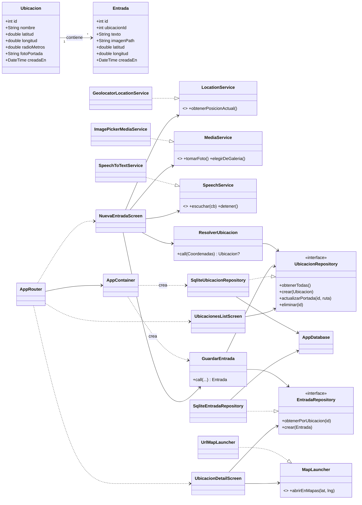
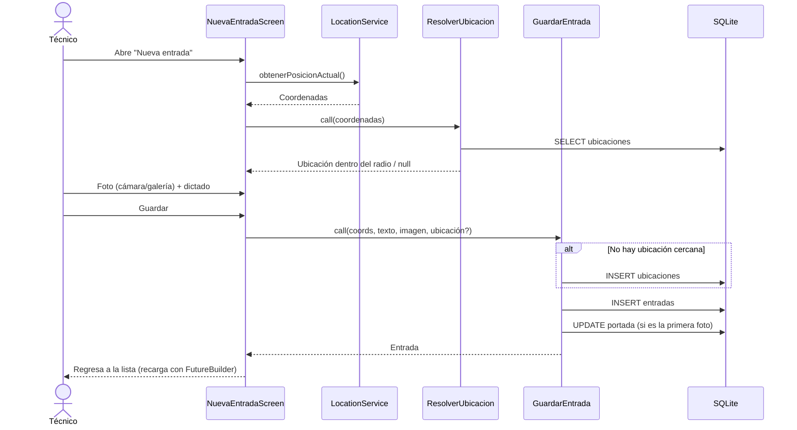

# Arquitectura — base para el reporte técnico

## Diagrama de clases

## Flujo de datos — guardar una entrada

## Principios SOLID aplicados

- **S** — cada clase tiene una responsabilidad: repositorios persisten, servicios hablan con el hardware, casos de uso aplican reglas, pantallas muestran.
- **O** — se puede cambiar SQLite por otra persistencia creando otra implementación del repositorio, sin tocar dominio ni UI.
- **L** — cualquier implementación de `LocationService` (real o falsa para pruebas) funciona igual en la pantalla.
- **I** — un servicio por gadget, en lugar de una interfaz "Dispositivo" gigante.
- **D** — dominio y UI dependen de interfaces; solo `AppContainer` conoce las clases concretas, y las pantallas reciben dependencias por constructor.
